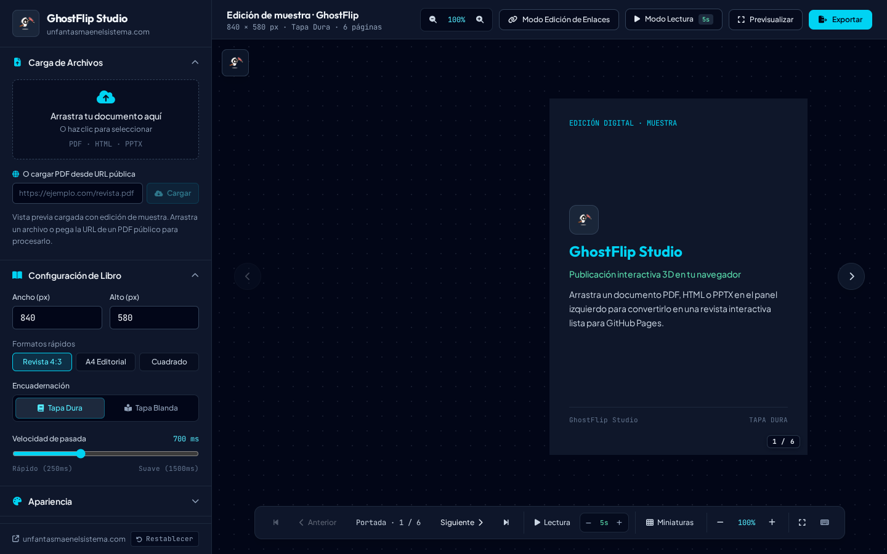
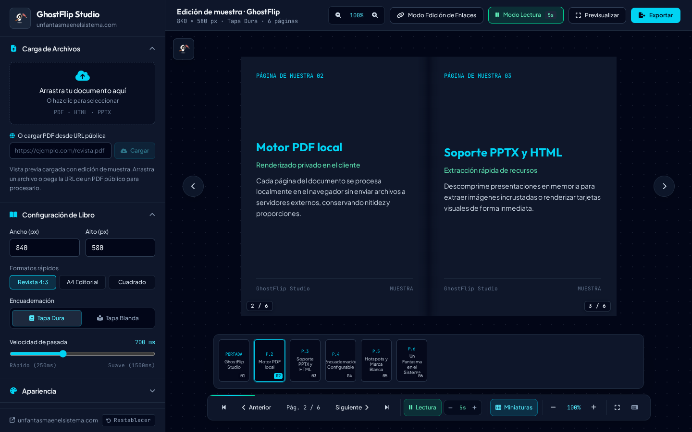
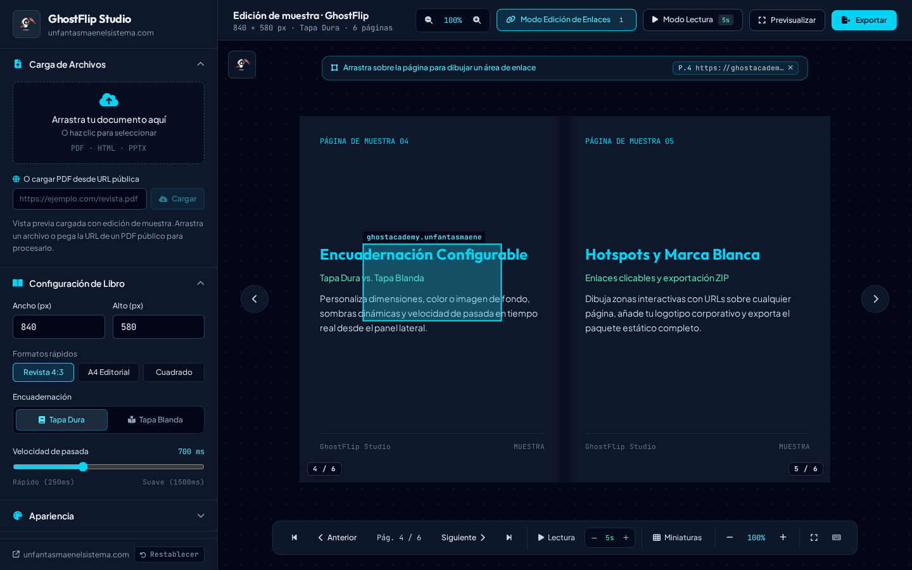
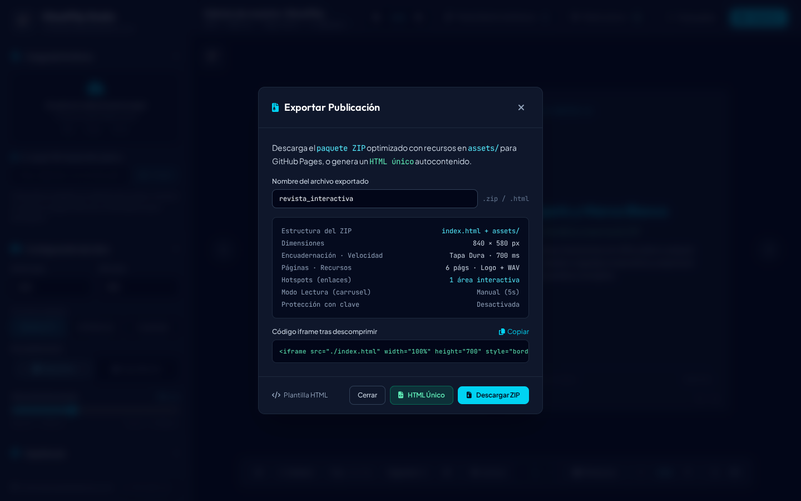

# GhostFlip Studio

🌐 **Demo en vivo:** https://unfantasmaenelsistema.github.io/GhostFlipStudio/

Estudio web interactivo para convertir documentos **PDF (locales o remotos por URL)**, **PPTX** y **HTML** en revistas digitales 3D con efecto realista de paso de página, **Modo Lectura** tipo carrusel, **Editor visual de Hotspots**, **Marca Blanca / SEO**, protección por contraseña en cliente y exportación optimizada en **paquete ZIP** o **HTML único autocontenido** listo para **GitHub Pages**.

---

## Capturas reales de la aplicación

### Vista principal del Studio


### Doble página abierta, miniaturas y Modo Lectura automático


### Editor visual de Hotspots (áreas interactivas clicables)


### Modal de exportación (ZIP optimizado y HTML único)


---

## Funcionalidades principales

- **Carga local y remota de documentos:**
  - Arrastra o selecciona archivos **PDF**, **PPTX** o **HTML**.
  - Carga **PDFs públicos desde URL** (`http://` / `https://`) mediante proxy integrado (`/api/remote-pdf` con protección SSRF, límite de 50 MB y verificación de firma `%PDF-`) y respaldo automático por CORS directo en despliegues estáticos.
  - Ajuste automático de dimensiones y relación de aspecto según el documento cargado.
- **Motor 3D realista (`StPageFlip`):**
  - Escalado nativo `size: "stretch"` centrado en el lienzo sin distorsión de coordenadas.
  - Encuadernación configurable (**Tapa Dura** vs. **Tapa Blanda**), velocidad de pasada (`250 ms` – `1500 ms`), sombras dinámicas en lomo y bordes, y sonido acústico opcional al pasar página.
  - Numeración dinámica superpuesta en las esquinas inferiores (`X / N`), alternando derecha/izquierda según el pliego.
  - Carga diferida en memoria (`n-1`, `n`, `n+1`, `n+2`) para optimizar RAM en documentos largos.
- **Modo Lectura (Carrusel de presentación):**
  - Transición automática configurable entre **1 y 60 segundos** desde el panel lateral, la barra superior o la barra inferior del visor.
  - Barra de progreso animada, pausa automática al editar enlaces y retorno continuo desde la contraportada a la portada.
- **Editor de Hotspots (Enlaces interactivos):**
  - Activa el *Modo Edición de Enlaces* y dibuja rectángulos directamente sobre cualquier página visible.
  - Coordenadas porcentuales responsivas guardadas e incrustadas como enlaces `<a>` invisibles tanto en el visor del Studio como en la exportación final.
- **Marca Blanca, SEO y Seguridad:**
  - Logotipo corporativo flotante (esquina superior izquierda o derecha) con URL de destino personalizable.
  - Metadatos `<title>`, `<meta description>`, `<meta keywords>` y OpenGraph inyectados en el HTML exportado.
  - Protección opcional por contraseña verificada en el cliente mediante hash FNV-1a con sal.
  - Persistencia automática de preferencias en `localStorage` con opción de restablecimiento.
- **Exportación dual:**
  - **Paquete ZIP (`*.zip`)**: genera `index.html`, `assets/pages/page-*.jpg`, `assets/logo.*` y `assets/page-flip.wav`, ideal para subir directamente a GitHub Pages o cualquier servidor web.
  - **HTML Único (`*.html`)**: compila todo el visor y los recursos en un solo archivo descargable y portable.

---

## Atajos de teclado en el visor

| Atajo | Acción |
| --- | --- |
| `←` / `→` | Página anterior / siguiente |
| `Home` / `End` | Ir a la portada / contraportada |
| `R` | Iniciar o pausar **Modo Lectura** |
| `F` | Activar o salir de **Pantalla completa** |
| `Esc` | Salir del modo Previsualizar o cerrar diálogos |

---

## Stack tecnológico

- **Frontend:** React 19, TypeScript, Vite 8, Tailwind CSS v4, FontAwesome 6
- **Motor Flipbook y parsing en cliente:** `page-flip` (`StPageFlip 2.0.7`), `pdf.js 3.11.174`, `JSZip 3.10.1`, `FileSaver.js 2.0.5`
- **Backend opcional (carga remota de PDFs sin CORS):** Node.js 22+, Express 4 (el proxy valida cada redirección contra IPs privadas)

---

## Estructura del proyecto

```text
.
├── .github/workflows/ci.yml   # Pipeline de verificación (typecheck + build)
├── docs/screenshots/          # Capturas reales usadas en este README
├── public/                    # Recursos estáticos (logo por defecto y plantilla HTML)
├── src/
│   ├── components/
│   │   ├── ExportModal.tsx    # Modal de exportación ZIP / HTML único y snippet iframe
│   │   ├── FlipbookStage.tsx  # Escenario 3D, numeración, Modo Lectura y editor de hotspots
│   │   └── Sidebar.tsx        # Panel lateral de configuración, carga local/URL y marca blanca
│   ├── types/flipbook.ts      # Tipos TypeScript de configuración, páginas y hotspots
│   ├── utils/
│   │   ├── documentParser.ts  # Procesamiento local/remoto de PDF, PPTX y HTML
│   │   ├── exporter.ts        # Generación de paquete ZIP y HTML standalone
│   │   └── sound.ts           # Audio Base64 WAV de paso de página
│   ├── App.tsx                # Estado global, persistencia y barra superior
│   └── index.css              # Estilos globales Tailwind v4 y reglas de visor
├── server.ts                  # Servidor Express + Vite middleware + proxy /api/remote-pdf
├── package.json
└── vite.config.ts
```

---

## Instalación y uso local

### Requisitos previos
- **Node.js 20+** (recomendado **Node.js 22+**)
- **npm**

### Pasos

```bash
# 1. Clonar el repositorio
git clone https://github.com/unfantasmaenelsistema/GhostFlipStudio.git
cd GhostFlipStudio

# 2. Instalar dependencias
npm install

# 3. Iniciar en modo desarrollo (Express + Vite en http://localhost:3000)
npm run dev
```

### Otros scripts disponibles

```bash
# Verificar tipos TypeScript
npm run lint

# Compilar bundle de producción en dist/
npm run build

# Ejecutar servidor en producción (sirve dist/ y /api/remote-pdf)
NODE_ENV=production npm start
```

---

## Despliegue

### Modo estático (GitHub Pages / Netlify / Vercel)
Este repositorio se publica solo en GitHub Pages con el workflow `.github/workflows/ci.yml` (build con `GITHUB_PAGES=true`, que fija la base `/GhostFlipStudio/`). Para otro alojamiento:
1. Ejecuta `npm run build`.
2. Publica el contenido de la carpeta `dist/`.
> Nota: En alojamiento puramente estático sin Node.js, la carga de archivos locales (PDF, PPTX, HTML) funciona al 100 % en el navegador y la carga de PDFs por URL usa `fetch(..., { mode: 'cors' })` directo sobre servidores que permitan CORS.

### Modo completo con proxy remoto (`/api/remote-pdf`)
Despliega el proyecto en cualquier entorno Node.js 22+ (Railway, Render, Fly.io, VPS o Cloud Run) ejecutando:

```bash
npm ci
npm run build
NODE_ENV=production npm start
```

---

## Variables de entorno

Consulta `.env.example`. El Studio no usa ninguna clave API; opcionalmente puedes definir `PORT` (por defecto `3000`).

---

## Licencia

Distribuido bajo licencia [MIT](LICENSE).
